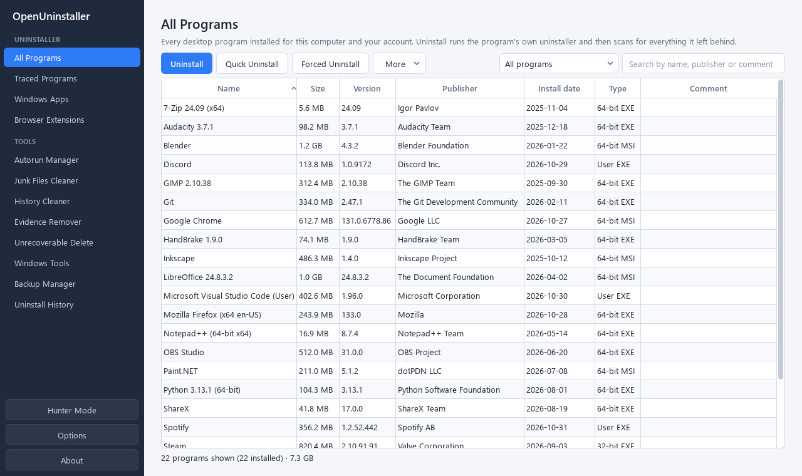
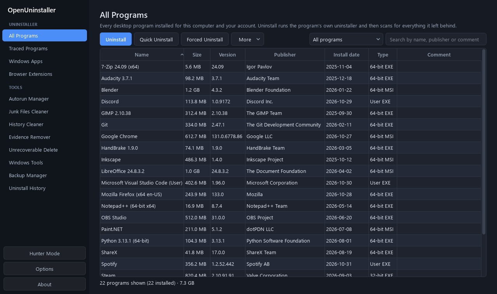
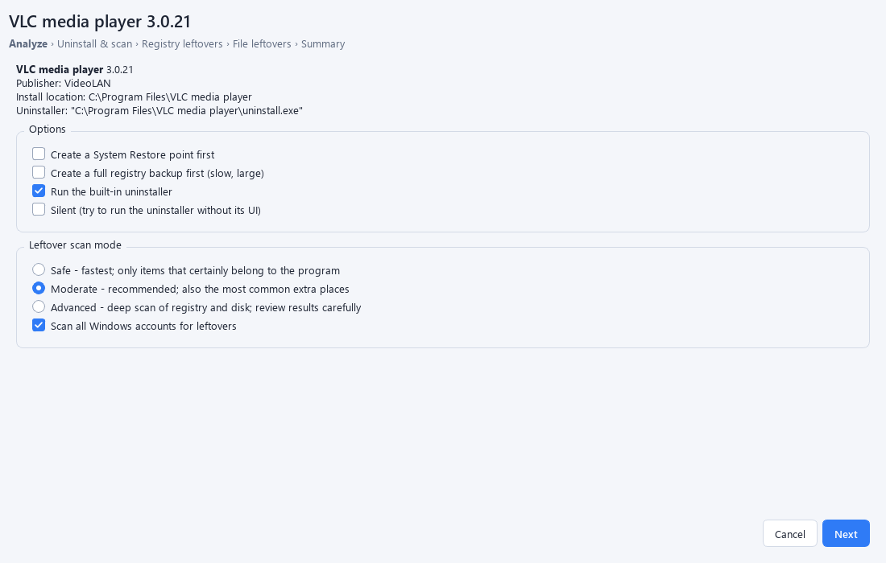
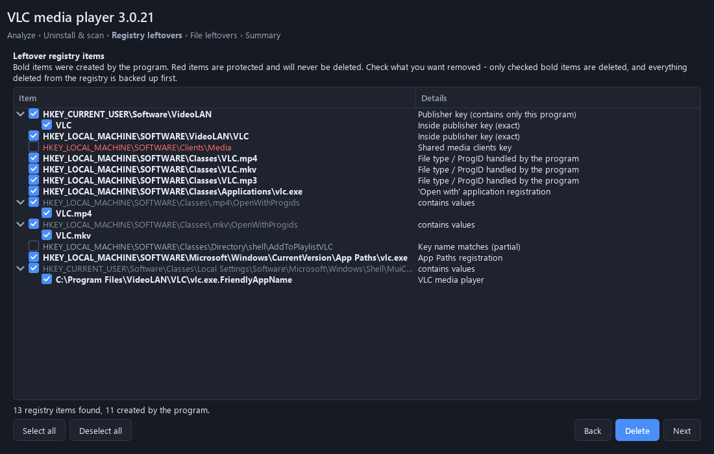
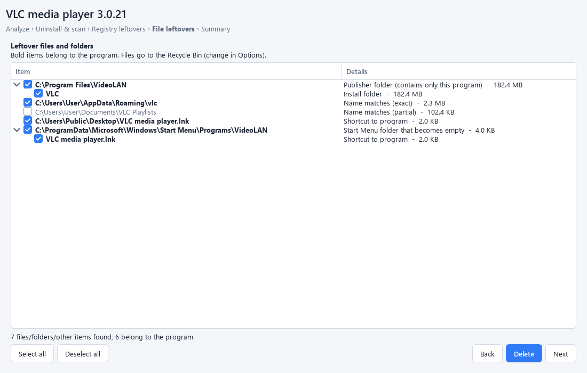
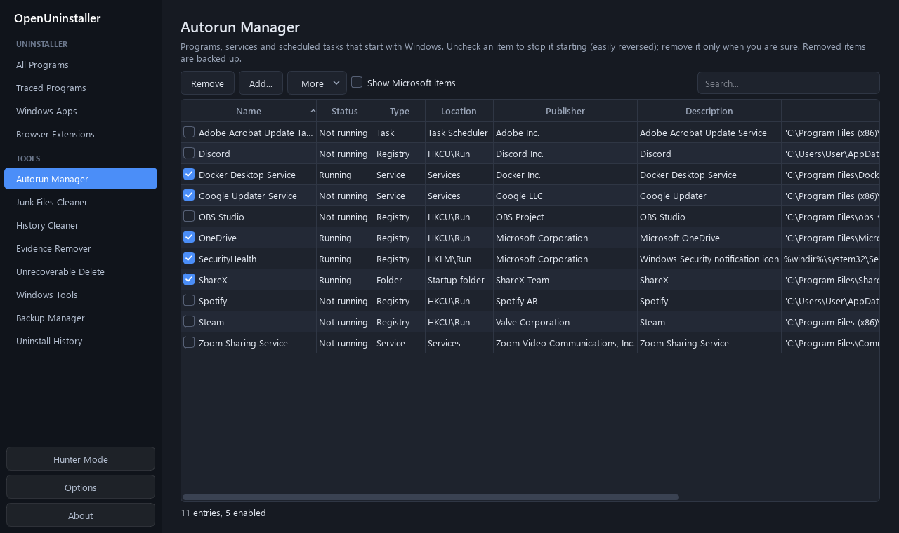
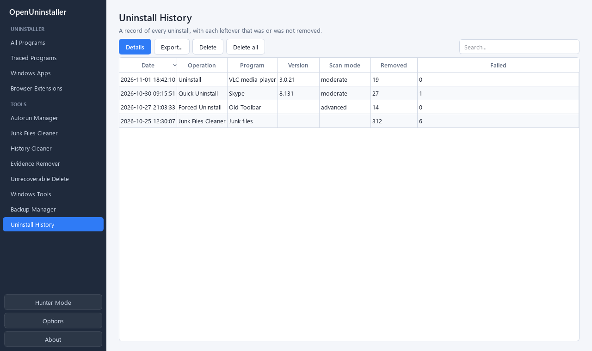

# OpenUninstaller

A free, open-source (MIT) Windows uninstaller. It removes programs completely, including the
files, folders and registry entries their own uninstallers leave behind. There is no subscription and no
telemetry.

Written from scratch in Python + PySide6. The feature set follows what a power-user uninstaller is
expected to do, but none of the code or data comes from any commercial product.

## Screenshots

| Light | Dark |
|---|---|
|  |  |

**Uninstall wizard.** Run the program's own uninstaller, then review what it left behind. **Bold** items
were created by the program; red items are protected and are never deleted.

| | |
|---|---|
|  |  |
|  |  |



<sub>Screenshots use sample data. Regenerate them with `.venv\Scripts\python docs\make_screenshots.py`.</sub>

## Install

Download **`OpenUninstaller-<version>-Setup.exe`** from the
[Releases](https://github.com/VighneshKunjir/OpenUninstaller/releases) page and run it. Windows 10/11 x64.
The installer can optionally add "Uninstall with OpenUninstaller" to the Explorer right-click menu. It
registers a normal uninstaller in *Apps & features*, which asks whether to keep your backups and history.

> Windows SmartScreen may warn about an unknown publisher because the installer is not code-signed.
> Choose *More info → Run anyway*, or build it yourself from source (see below).

## Run from source

```bat
setup.bat                      :: once - creates .venv and installs requirements
"Run OpenUninstaller.bat"      :: starts the GUI (it will offer to restart as administrator)
```

## Build the installer

```bat
winget install JRSoftware.InnoSetup     :: once
packaginguild.bat                     :: -> dist\OpenUninstaller\ and release\OpenUninstaller-<version>-Setup.exe
```
`packaging/OpenUninstaller.spec` (PyInstaller) and `packaging/installer.iss` (Inno Setup) hold the build
settings. Bump the version in `openuninstaller/__init__.py`, `packaging/version_info.txt` and
`packaging/installer.iss` together.

Run it as **administrator** to remove programs installed for all users, delete services and create
restore points. Without admin rights it still works for per-user programs.

## Features

### Uninstaller
| Module | What it does |
|---|---|
| **All Programs** | Lists everything in the 64-bit, 32-bit and per-user `Uninstall` registry keys, with search, filters (new, 32/64-bit, per user, MSI, large, groups), comments, groups, hide, export (CSV/HTML/TXT/JSON), Change/Repair, and links to open the install folder or registry key |
| **Uninstall wizard** | Analyze → restore point (+ optional full registry backup) → built-in uninstaller → leftover scan → review registry items → review files → summary |
| **Quick Uninstall** | Runs the uninstaller silently, scans in Moderate mode and removes leftovers automatically. Works on several programs at once |
| **Forced Uninstall** | Cleans up after broken, half-removed or unlisted programs, using a name and/or install folder/exe. Finds any matching built-in uninstallers |
| **Forced MSI Uninstall** | `msiexec /x {ProductCode}`, for MSI entries whose uninstaller opens "repair" instead |
| **Traced Programs** | Install a program *through* OpenUninstaller. Every file, folder, registry key and value it creates is recorded in a trace log, so it can later be removed 100%. Logs can be viewed, renamed, merged, exported/imported (`.oulog`), and survive a reboot during install |
| **Windows Apps** | Store/UWP/MSIX apps: uninstall (also for all users), quick uninstall, reset, terminate, run, reset Microsoft Store, plus leftover scan |
| **Browser Extensions** | Chrome, Edge, Brave, Vivaldi, Opera and Firefox. Shows extensions planted by other software (`External`/`Policy` source) and removes them |
| **Hunter Mode** | Drag the crosshair onto any program window to uninstall it, stop it autostarting, kill it, kill and delete it, open its folder, search the web for it, or view its properties |
| **Explorer integration** | Optional "Uninstall with OpenUninstaller" for folders, shortcuts and .exe files, and "Install with OpenUninstaller (trace)" for installers |

### Tools
**Autorun Manager** (Run/RunOnce, Startup folders, auto-start services, logon/boot scheduled tasks; enable/disable/remove/add, remove invalid, remove disabled) ·
**Junk Files Cleaner** (configurable patterns, excludes, always-clean folders, skip recently used files) ·
**History Cleaner** (Windows MRUs, temp files, thumbnails, jump lists, dumps; Chrome/Edge/Brave/Firefox caches and history; Office recent files) ·
**Evidence Remover** (3-pass free-space wipe) ·
**Unrecoverable Delete** (3-pass shredder with drag and drop) ·
**Windows Tools** (25 built-in tools plus your own) ·
**Backup Manager** (restore everything or selected items; delete by date) ·
**Uninstall History** (every removed or failed item, exportable).

### Command line
```bat
.venv\Scripts\python -m openuninstaller list --filter chrome
.venv\Scripts\python -m openuninstaller scan "Discord" --mode advanced     :: read-only preview
.venv\Scripts\python -m openuninstaller uninstall "Some App" --quiet --mode moderate
.venv\Scripts\python -m openuninstaller forced --name "Old App" --path "C:\Program Files\Old App"
.venv\Scripts\python -m openuninstaller backups | restore <id> | history | autoruns
```

## How the leftover scan works

`openuninstaller/leftovers.py` builds a **target** from the program's uninstall entry: name, publisher,
install folder, uninstall key name, MSI product code and the executables in the install folder. It then
derives keyword sets from it:

* **strong** names: the cleaned display name (versions, `(x64)`, `®` and installer words stripped), the
  name without its publisher prefix ("Mozilla Firefox" → "Firefox"), the install folder name (or its parent
  when the folder is a generic `Application`/`bin`), and the uninstall key name
* **weak** names: executable names and the first word of multi-word names
* the **publisher** with `Inc`, `Ltd`, `GmbH`, `Software` and similar suffixes removed

Names are compared after normalisation (lower case, letters and digits only). A candidate is an **exact**
match (shown in bold, safe to delete) or a **partial** match (shown in gray, which you mark yourself).

| Mode | Locations checked |
|---|---|
| **Safe** | Uninstall key · install folder · exact-name folders in Program Files (x86/x64), Common Files, ProgramData, AppData Roaming/Local/LocalLow, `Local\Programs`, Start Menu · shortcuts (.lnk targets resolved) on Desktop/Start Menu/taskbar · `Software\<name>` and `Software\<Publisher>\<name>` in HKCU and HKLM (64- and 32-bit views) · Run/RunOnce values and StartupApproved records · App Paths · services whose ImagePath is in the install folder · scheduled tasks whose action runs from it |
| **Moderate** | + publisher folders and keys that contain *only* this program · partial name matches · Documents, Temp, user-profile dot-folders · firewall rules · SharedDLLs · Windows Installer registration (packed GUID under `Installer\Products`, `Features`, `UserData`, `UpgradeCodes`) · file types / ProgIDs and "Open with" entries |
| **Advanced** | + COM classes (`CLSID\…\InprocServer32/LocalServer32` in the install folder) · type libraries · MuiCache, Compatibility Assistant and AppCompat layers · Installer folder records · a 4-level deep registry walk and a 3-level deep folder walk for exact names |

The *all user accounts* option also scans other profiles' AppData, Desktop and Start Menu, plus the
`HKEY_USERS` hives of accounts that are loaded.

**Safety rails.** System folders, known roots and their ancestors, generic folder names (`Microsoft`,
`Common Files`, `Packages`…) and a user-editable exclude list (wildcards supported) are never deleted.
Registry keys at hive or `Software` level and a default exclude list are never deleted either. Only
items that are both **checked and bold** are deleted. Registry items are exported to `.reg` (values are
saved with their exact type and data) before deletion. Files go to the Recycle Bin by default; you can
choose the backup folder or permanent delete instead. Files that are locked are scheduled for deletion
at the next reboot.

**Built-in uninstaller handling.** Many uninstallers (Inno Setup, NSIS, InstallShield) copy themselves to
`%TEMP%` and relaunch. The wizard follows the whole process tree and watches for these relaunched
processes, so the leftover scan starts only once the uninstaller has really finished. *Continue* skips the
wait if an uninstaller hangs.

**Traced installs.** Without a kernel driver, tracing is done by snapshot diff: before and after the
install it records the file system (Program Files, ProgramData, AppData, Start Menu, Desktop, Documents,
System32 top level, Tasks) and the registry (HKCU\Software, HKLM\SOFTWARE in both views,
Services). A snapshot takes about 30 s. Only the top-most new folders and keys are stored, so uninstalling
from a log is exact.

**Phone and cloud storage.** Phone Link ("CrossDevice"), OneDrive, Dropbox, iCloud and similar services
mount folders on your local drive whose files really live on another device. They are detected from
Windows' sync-root registry and from the online-only file attributes. By default they are **never
scanned or deleted**: the Junk Cleaner, leftover scans, install tracing, the shredder and the deletion
engine itself all skip them. You can opt in under *Options → General → Include phone and cloud storage
folders* (or with the checkbox on the Junk Cleaner page). Even then, phone/cloud files found by the Junk
Cleaner are listed unchecked. Folder junctions and symlinks are never followed.

## Tests
```bat
.venv\Scripts\python tests\test_e2e_uninstall.py     :: fake app: uninstall, scan, delete, restore
.venv\Scripts\python tests\test_cloud_exclusion.py   :: phone/cloud folders are skipped (deletes are stubbed)
.venv\Scripts\python tests\test_gui_smoke.py         :: every page and dialog opens without errors
.venv\Scripts\python tests\test_wizard_flow.py       :: "leftovers not deleted" popup, Back, history on Finish
```

## Data locations
Everything lives in `%LOCALAPPDATA%\OpenUninstaller` (`settings.json`, `Backups\`, `History\`,
`TraceLogs\`, `RegistryBackups\`). Junk Cleaner deletions are recorded in Uninstall History too.

## Limitations
* Trace logs only see changes inside the snapshotted locations (add more in `settings.json` →
  `trace_roots_extra`). Changes made by other programs during the trace are recorded too, so
  trace one install at a time.
* Hunter Mode identifies windows, not desktop icons. Use the Explorer context-menu entry for icons.
* On SSDs, overwriting (Evidence Remover / Unrecoverable Delete) can't guarantee physical erasure
  because of wear levelling. TRIM already makes most deleted data unrecoverable.
* There is no online database of pre-made logs.

## License
MIT. See `LICENSE`.
